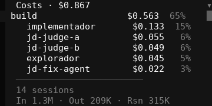

# opencode-costs

Sidebar cost panel for **OpenCode 2.x**: cost and tokens per agent for the active session **and every subagent below it**.



## What it shows

- **Header**: total cost of the session family (the session plus all its descendants), with a `▾`/`▸` toggle.
- **One row per agent**: cost, share of the family total and an indent that mirrors the subagent depth.
- **Footer**: number of sessions in the family and aggregate input / output / reasoning tokens.
- **Live**: it re-renders on every session event OpenCode pushes, plus a 30-second safety sync.

Click the header to collapse the panel; the choice is stored in the plugin's durable state.

## Why 2.0 is a rewrite

The 1.x version was a Python CLI (`costs`) that read OpenCode's SQLite database. That broke with OpenCode 2.x for two separate reasons:

1. **The database moved.** OpenCode 1.x wrote sessions to `session`; 2.x writes new sessions to `session_v2` (messages to `session_message`). The legacy tables stop receiving rows, so the CLI kept reporting an old session and its subagents disappeared.
2. **TUI plugins changed.** In OpenCode 2.x a sidebar plugin is an **npm package** that uses the `@opencode/plugin/tui` API; local files and the old `tui.json` entries are not loaded. A menu command cannot live next to it either.

So 2.0 drops the CLI and the Python engine entirely. The panel now reads the session store of the running OpenCode: no SQLite, no external process, no second runtime. That also means **it only supports OpenCode 2.x**; `1.x` is no longer supported.

## Install

```sh
opencode plugin add opencode-costs-tui
```

Or:

```sh
curl -fsSL https://raw.githubusercontent.com/caertos/opencode-costs/main/install.sh | sh
```

Restart OpenCode (or run `/reload`). The panel appears at the top of the session sidebar.

Uninstall:

```sh
opencode plugin remove opencode-costs-tui
```

## What the numbers mean

- **Cost** comes from OpenCode's own session accounting. If the provider or model has no price configured (some free tiers, local models), the cost is `$0.00` while tokens are still reported.
- **Family** = the session you are looking at, plus every session whose `parentID` chain starts there. Subagents created by task/delegation tools are included.
- **Agent rows** are grouped by agent name; an agent that ran several sub-sessions shows the sum and the count in the footer.

## Requirements

- OpenCode **2.x** with the TUI plugin API (verified on 2.4.0).
- No Python, no database access, no API key: the plugin only formats data the host already has.

## Development

```sh
npm test          # pure-logic tests (node --test, no dependencies)
```

To try a local checkout before publishing, point OpenCode at the repository as a git package:

```sh
# ~/.config/opencode/cli.json
{
  "plugins": ["git+file:///absolute/path/to/opencode-costs"]
}
```

Then restart the TUI. Remember to remove that entry before going back to the published package.

## License

MIT
