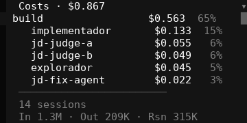

# opencode-costs

Panel de costes en la barra lateral de **OpenCode 2.x**: coste y tokens por agente de la sesión activa **y de todos sus subagentes**.



## Qué muestra

- **Cabecera**: coste total de la familia de sesiones (la sesión más todos sus descendientes), con un conmutador `▾`/`▸`.
- **Una fila por agente**: coste, porcentaje sobre el total de la familia y sangría según la profundidad del subagente.
- **Pie**: número de sesiones de la familia y tokens agregados de entrada / salida / razonamiento.
- **En vivo**: se repinta con cada evento de sesión que emite OpenCode, más una sincronización de seguridad cada 30 segundos.

Haz clic en la cabecera para plegar el panel; la elección se guarda en el estado duradero del plugin.

## Por qué 2.0 es una reescritura

La versión 1.x era un CLI en Python (`costs`) que leía la base SQLite de OpenCode. Se rompió con OpenCode 2.x por dos motivos independientes:

1. **La base de datos cambió.** OpenCode 1.x escribía las sesiones en `session`; 2.x escribe las nuevas en `session_v2` (y los mensajes en `session_message`). Las tablas antiguas dejan de recibir filas, así que el CLI seguía mostrando una sesión vieja y sus subagentes desaparecían.
2. **Los plugins de TUI cambiaron.** En OpenCode 2.x un plugin de barra lateral es un **paquete npm** que usa la API `@opencode/plugin/tui`; los archivos locales y las entradas antiguas de `tui.json` no se cargan. Tampoco cabe un comando de menú al lado.

Por eso 2.0 elimina el CLI y el motor en Python. El panel lee el almacén de sesiones de OpenCode en ejecución: sin SQLite, sin proceso externo y sin un segundo runtime. Como contrapartida, **solo soporta OpenCode 2.x**; `1.x` deja de estar soportado.

## Instalación

```sh
opencode plugin add opencode-costs-tui
```

O:

```sh
curl -fsSL https://raw.githubusercontent.com/caertos/opencode-costs/main/install.sh | sh
```

Reinicia OpenCode (o ejecuta `/reload`). El panel aparece al principio de la barra lateral de la sesión.

Desinstalar:

```sh
opencode plugin remove opencode-costs-tui
```

## Qué significan los números

- **Coste**: sale de la contabilidad de sesiones de OpenCode. Si el proveedor o el modelo no tienen precio configurado (algunas capas gratuitas, modelos locales), el coste es `$0.00` y los tokens se siguen mostrando.
- **Familia**: la sesión que estás viendo más todas aquellas cuya cadena de `parentID` empieza ahí. Incluye los subagentes que crean las herramientas de tarea/delegación.
- **Filas de agente**: agrupadas por nombre de agente; si un agente ejecutó varias sub-sesiones, se muestra la suma y el total de sesiones aparece en el pie.

## Requisitos

- OpenCode **2.x** con la API de plugins de TUI (verificado en 2.4.0).
- Sin Python, sin acceso a la base de datos y sin claves: el plugin solo formatea datos que el host ya tiene.

## Desarrollo

```sh
npm test          # tests de lógica pura (node --test, sin dependencias)
```

Para probar un checkout local antes de publicar, apunta OpenCode al repositorio como paquete git:

```sh
# ~/.config/opencode/cli.json
{
  "plugins": ["git+file:///ruta/absoluta/a/opencode-costs"]
}
```

Reinicia la TUI. Acuérdate de quitar esa entrada antes de volver al paquete publicado.

## Licencia

MIT
